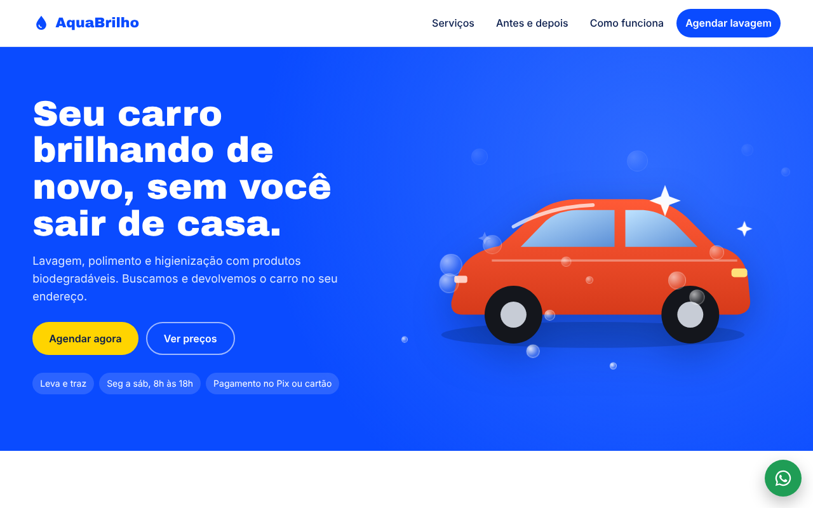

# AquaBrilho — Site de lava-rápido e estética automotiva

Site completo para lava-rápido, com serviços, fotos de antes e depois e agendamento online com vagas por horário.



## Funcionalidades

- **Preços por porte do veículo:** alterna entre hatch/sedã e SUV/picape e os valores mudam na hora.
- **5 pacotes de serviço** com o que está incluso em cada um.
- **Galeria antes e depois** com comparador deslizante (arraste a barra).
- **Agendamento com vagas por horário** (2 boxes), bloqueio de horários passados e de serviços longos no fim do dia.
- **Leva e traz** com taxa e endereço de busca.
- Validação de placa e telefone, resumo do pedido e confirmação pelo WhatsApp.
- Botão flutuante de WhatsApp, menu mobile e animação de bolhas no topo.

## Fotos reais

A galeria vem com ilustrações. Para usar fotos de verdade, coloque as imagens na pasta `img/` e preencha os campos `antes` e `depois` da lista `GALERIA` no `js/script.js`:

```js
{ titulo: 'Lavagem completa', legenda: 'Hatch prata', desenho: 'externo', cor: '#b9c2cf',
  antes: 'img/hatch-antes.jpg', depois: 'img/hatch-depois.jpg' }
```

## Como rodar

Não precisa instalar nada. Baixe o projeto e abra o `index.html` no navegador.

Para publicar, envie a pasta para a **Netlify** (arraste e solte) ou ative o **GitHub Pages** em *Settings → Pages*.

## Personalizar

- **WhatsApp:** troque o número na constante do início do `js/script.js` (formato `5551999999999`).
- **Serviços, preços e equipe:** ficam em listas no topo do `js/script.js`.
- **Cores:** variáveis CSS no início do `css/style.css`.

## Tecnologias

HTML5 · CSS3 (Grid, Flexbox, variáveis, `:has()`) · JavaScript puro (sem frameworks) · `localStorage`

---
Feito por **Vinicius Lima** · [viniciuslimadev.netlify.app](https://viniciuslimadev.netlify.app)
